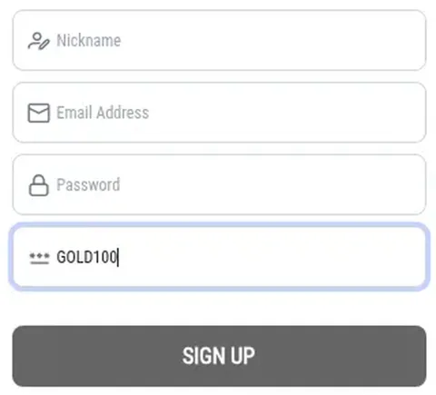

# ACR Poker (WPN) referral code: GOLD100 (as of November 2026)

**GOLD100 is the referral code for ACR Poker on the Winning Poker Network.** Type it in the last box of the sign-up form, "Referral Code (Optional)", and the code's offer is 27% daily rakeback.

## Where do I put GOLD100?

On the ACR Poker "Create Your Account" form, the final field is "Referral Code (Optional)". Enter the code there before you submit.

## How to join with the code

1. Open the ACR Poker sign-up form.
2. Fill in your details and choose a username.
3. Go to "Referral Code (Optional)" at the bottom.
4. Type `GOLD100`.
5. Create the account.

## What is the rakeback offer?

The offer tied to GOLD100 is 27% daily rakeback. The network's own terms govern how it's paid.

## Mistakes to avoid

- Leaving the optional box empty because it looks skippable.
- Typing the letter O instead of zeros.
- Opening the account and adding the code later.

## FAQ

**Is WPN the same as ACR?** ACR Poker is the main site on the Winning Poker Network, and the code goes in during ACR sign-up.

**Promo code or referral code?** Both terms get used; the form calls it a referral code.

---
*18+ only. Play responsibly and only where online poker is legal for you. Disclosure: GOLD100 is our referral code; we may earn a reward when it's used.*
